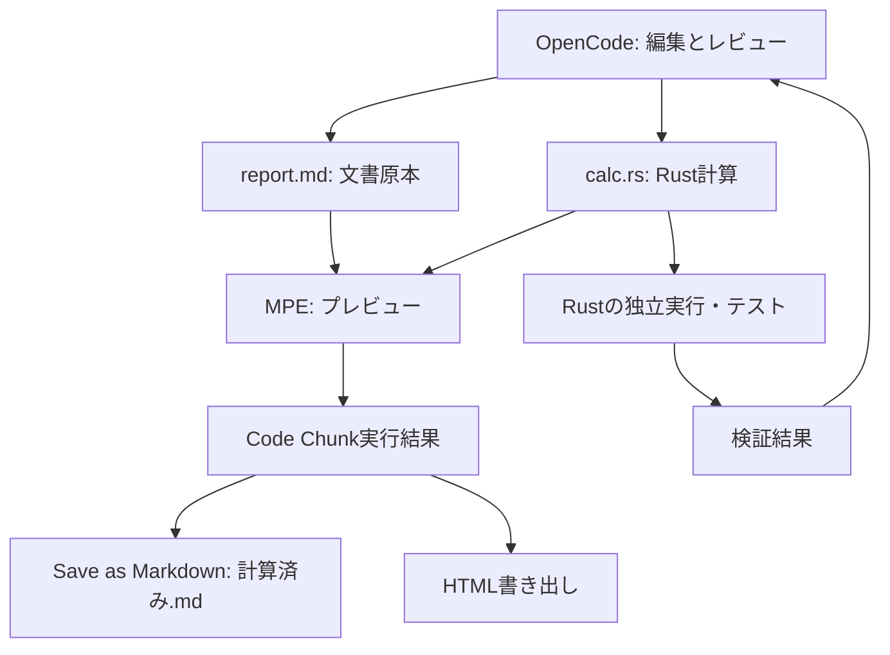

> **Status note (2026-11-15):** 本書は MPE/Rust/LaTeX 文書構成に関する参照レポート（proposed）です。現行 JARVIS の実行基盤・運用タスクの管理は [ADR-0004: Local-only (no OCI)](../../adr/0004-local-only-no-oci.md) と [docs/integration/remaining-tasks.md](../../docs/integration/remaining-tasks.md) を参照してください。

## 1. エグゼクティブサマリー

### 1.1 結論

**採用候補は「OpenCode + Markdown Preview Enhanced（MPE）+ Rust + LaTeX数式記法」である。**
文書原本は `.md` とし、計算ロジックを Rust に分離する。日常の編集と閲覧は
VS Code系エディタおよび MPE で完結させ、共有時に限って計算済み Markdown
または HTML を書き出す。PDFの生成は必須要件としない。

この設計は、文章をテキストとして扱いやすいこと、計算の実装・単体テストを
Rust に集約できること、AIエージェントがGit差分を確認しやすいことを優先する。
**MPEは文書の表示・実行インターフェースであり、表計算エンジンや
LaTeXコンパイラの代用品ではない。**

### 1.2 推奨事項

| 区分 | 推奨 | 理由 |
| --- | --- | --- |
| 文書原本 | Markdown（`.md`） | 可読性、差分管理、移植性 |
| 数式の表示 | `$...$`、`$$...$$` のLaTeX数式記法 | MPEとGitHubで表示可能 |
| 計算 | Rust | 型、テスト、再現可能な計算ロジック |
| 実行手段 | MPE Code Chunk + `rust-script` | 編集中のプレビューへ結果を挿入 |
| 複雑な処理 | CargoプロジェクトのRustプログラム | 依存関係とテストの統制 |
| 編集支援 | OpenCode | 変更、生成、レビュー、検証の支援 |
| 通常閲覧 | MPEプレビュー | 数式、表、実行結果を同一画面で確認 |
| 共有 | 計算済みMarkdown、必要ならHTML | 受け手側の実行環境を不要にする |
| PDF | 任意 | 必要な場合にのみ書き出す |

**設計上の重要な区別：** Markdown原本、MPEの表示結果、共有用の出力ファイルは
異なる成果物である。MPE独自の実行構文を含む `.md` は、一般のMarkdown
レンダラーでは同一表示にならない。

根拠：
[MPE Code Chunk](https://github.com/shd101wyy/markdown-preview-enhanced/blob/master/docs/code-chunk.md)、
[MPE Save as Markdown](https://github.com/shd101wyy/markdown-preview-enhanced/blob/master/docs/markdown.md)、
[GitHub数式サポート](https://docs.github.com/ja/get-started/writing-on-github/working-with-advanced-formatting/writing-mathematical-expressions)。

## 2. 要件と非要件

### 2.1 機能要件

1. 説明文、見出し、表、リンク、数式をMarkdownで編集できる。
2. 計算をRustで実装し、実行結果を本文中の指定箇所に表示できる。
3. 同じ計算処理を文書の表示とは独立に再実行・検証できる。
4. 外部の `.rs` ファイルを文書から参照できる。
5. OpenCodeで変更した文書・コードをGit差分でレビューできる。
6. 必要な場合に、受け手がRustやMPEを持たなくても読める成果物を作れる。

### 2.2 非機能要件

- 文章は人間がMarkdownとして読める形を優先する。
- Pythonの導入は必須としない。
- 原本の数値・計算結果の不一致を検出できる運用にする。
- 無断のファイル破壊、外部送信、スクリプト実行を避ける。
- PDF出力や完全なLaTeX文書を日常ワークフローに組み込まない。

## 3. アーキテクチャ



役割分担は以下とする。

- **Markdown：** 説明、表示位置、表、数式、参照資料。
- **Rust：** 入力値、関数、計算、検証、Markdown形式の結果出力。
- **MPE：** Markdownレンダリング、Rust実行コマンドへの橋渡し、プレビュー、共有用出力。
- **OpenCode：** 変更差分のレビュー、生成・テスト手順の実行支援。
- **Git：** 原本と計算ロジックの履歴管理。

### 3.1 推奨ディレクトリ構成

```text
project/
├── AGENTS.md
├── report.md
├── calc.rs
├── README.md
├── tests/                 # 必要に応じてCargoプロジェクトへ移行
└── dist/                  # 共有用の生成物（原本とは区別）
    ├── report.md
    └── report.html
```

`dist/` は生成物用とし、原本の `report.md` を直接上書きしない。

## 4. 最小構成の実装

### 4.1 前提条件

- VS Codeまたは対応するVS Code系エディタ。
- Markdown Preview Enhanced拡張機能。
- Rustツールチェーン（`rustc`、`cargo`）。
- `rust-script` コマンド。
- 自分で作成し、内容を確認した信頼済みワークスペース。

`rust-script` はCargoプロジェクトを手動作成せずにRustスクリプトを
実行できるツールである。初回実行やコード変更時にはコンパイルが発生する。

公式：
[MPEインストール](https://github.com/shd101wyy/markdown-preview-enhanced/blob/master/docs/vscode-installation.md)、
[rust-script](https://github.com/fornwall/rust-script)。

### 4.2 Rustスクリプトを導入する

Rustが導入済みの環境で、次のコマンドを実行する。

```console
cargo install rust-script
rust-script --version
```

これはシェル依存の制御構文を含まないため、Nushellからも個別に実行できる。

### 4.3 `calc.rs` を作成する

以下は標準ライブラリだけを使う最小の計算例である。
金額を整数で扱い、乗算にはオーバーフロー検査を入れる。

```rust
fn main() {
    let unit_price: u64 = 1_200;
    let quantity: u64 = 3;
    let total = unit_price
        .checked_mul(quantity)
        .expect("金額計算でオーバーフローしました");

    println!("| 項目 | 金額・数量 |");
    println!("| --- | ---: |");
    println!("| 単価 | {unit_price} 円 |");
    println!("| 数量 | {quantity} 個 |");
    println!("| **合計** | **{total} 円** |");
}
```

Rust単体での確認：

```console
rust-script calc.rs
```

期待される標準出力は次の通り。

```markdown
| 項目 | 金額・数量 |
| --- | ---: |
| 単価 | 1200 円 |
| 数量 | 3 個 |
| **合計** | **3600 円** |
```

### 4.4 `report.md` を作成する

次の例では、通常のMarkdown文章にLaTeX数式記法を書き、
外部RustファイルをMPEのCode Chunkとして実行する。

~~~markdown
# 費用計算レポート

## 算定式

単価を $P$、数量を $Q$ とすると、合計 $T$ は次の式で表される。

$$
T = P \times Q
$$

## 計算結果

@import "calc.rs" {cmd="rust-script" output="markdown" hide=true}
~~~

この `@import` 構文はMPE独自拡張であり、通常のMarkdown標準ではない。
MPEは外部ファイルをCode Chunkとしてインポートできる。
`output="markdown"` は標準出力をMarkdownとして解釈し、
`hide=true` はプレビュー上のコードを非表示にする。

公式：
[MPE外部ファイルのCode Chunkインポート](https://github.com/shd101wyy/markdown-preview-enhanced/blob/master/docs/file-imports.md)、
[MPE Code Chunk設定](https://github.com/shd101wyy/markdown-preview-enhanced/blob/master/docs/code-chunk.md)。

### 4.5 MPEでプレビューする

1. 信頼できるプロジェクトを開き、`report.md` を表示する。
2. MPEの拡張設定 `enableScriptExecution` を有効にする。
3. MPEのプレビューを開く。
4. Code Chunkの実行操作でRustを実行する。
5. 計算表が「合計 3600 円」と表示されることを確認する。
6. 入力値を変更した場合は再実行し、旧値が残っていないか確認する。

MPE公式には単一Chunkの実行 `shift-enter` と全Chunkの実行
`ctrl-shift-enter` が示されている。ショートカットが競合する場合は
コマンドパレットから実行する。

**注記：** コード実行は既定で無効。オンにする場合でも、
不明なMarkdownを開く作業と実行作業の環境を分離することを推奨する。

### 4.6 直接埋め込む代替パターン

一時的な計算ならRustコードをMarkdown内に直接書くこともできる。

~~~~markdown
```rust {cmd="rust-script" output="markdown" hide=true}
fn main() {
    let total = 1200 * 3;
    println!("**合計：{total}円**");
}
```
~~~~

長期運用では `calc.rs` の外部参照を優先する。
文書本文と計算ロジックを分離でき、Rust単体での実行・テストが容易になる。

## 5. LaTeXとの統合範囲

| 対象 | 対応方法 | 留意点 |
| --- | --- | --- |
| インライン数式 | `$a+b$` | 数値計算はしない |
| 独立した数式 | `$$...$$` | 数式のレンダリングのみ |
| Rustが出力した数値 | Code ChunkのMarkdown出力 | Rust側が演算する |
| Rustの出力に数式記法を含める | 要レンダラー検証 | MPEではMathJax処理に制限がある |
| `.tex` 文書のコンパイル | MPEのLaTeX Code Chunk | LaTeXエンジンと`pdf2svg`等が必要 |
| 外部`.tex`ファイルの直接参照 | 外部ファイルとして取り込み可能 | 通常の`@import`では原則コード表示、計算実行とは別 |

**LaTeX数式記法だけでは計算は実行されない。**
また、MPE公式は `output="markdown"` について、Markdownとして処理するが
MathJaxとグラフの処理はサポートされず、KaTeXは利用できる旨を記載している。
Rustの標準出力に複雑な数式を含める場合は、対象MPE版で表示確認する。

そもそも文書全体を `.tex` にする必要はない。
LaTeXを採用する理由は、主に数学的表記の可読性である。

公式：
[MPE Code Chunkの出力仕様・LaTeX対応](https://github.com/shd101wyy/markdown-preview-enhanced/blob/master/docs/code-chunk.md)、
[GitHub数式表示](https://docs.github.com/ja/get-started/writing-on-github/working-with-advanced-formatting/writing-mathematical-expressions)。

## 6. 日常運用と共有フロー

### 6.1 日常の編集

1. OpenCodeまたはエディタで `report.md`、`calc.rs` を編集する。
2. Rustを単体実行し、入力条件と結果を確認する。
3. MPEでMarkdownと計算結果を表示する。
4. 重要な数値を人間が再検証する。
5. Git差分を確認し、原本と計算ロジックをコミットする。

### 6.2 Markdownとして共有する場合

MPEプレビューの **Save as Markdown** を使用する。
この機能はCode Chunkの結果や画像を含むGitHub Flavored Markdownを
出力できるが、数式は画像化される場合があり、出力画像の配置や参照パスを
伴う点に注意する。原本Markdownを上書きせず、生成物は `dist/` に保存する。

共有前には、MPEを使わないGitHubなどの通常レンダラーで表示確認する。

重要：計算結果が原本に常時保存されるわけではない。
MPEには `modify_source=true` という原本に結果を書き込むオプションもあるが、
原本変更の副作用とGit差分のノイズが発生するため、初期構成では使わない。
同様に `run_on_save=true` による自動実行も初期状態では採用しない。

公式：
[MPE Save as Markdown](https://github.com/shd101wyy/markdown-preview-enhanced/blob/master/docs/markdown.md)、
[MPE Code Chunkオプション](https://github.com/shd101wyy/markdown-preview-enhanced/blob/master/docs/code-chunk.md)。

### 6.3 HTMLとして共有する場合

MPEのHTMLエクスポートを使う。
公式には `HTML (offline)` と `HTML (cdn hosted)` がある。
オフライン共有では埋め込み画像や外部リソースが機能するか確認する。
機微情報を含む場合はCDNへの依存を避け、出力HTML内の外部参照も検査する。

公式：
[MPE HTML Export](https://github.com/shd101wyy/markdown-preview-enhanced/blob/master/docs/html.md)。

### 6.4 長期的に完全な自動生成が必要になった場合

MPEのUI操作に依存せず、Rustから計算済みMarkdownを直接生成する
CLIを追加する。MPEは閲覧用に残せる。
CIや大量バッチ出力では、この独立CLI方式が適している。

## 7. 品質保証・OpenCode運用

### 7.1 最低限の品質ゲート

| 検証対象 | 合格条件 | 実施手段 |
| --- | --- | --- |
| Rustコード | エラーなし | `rust-script calc.rs` |
| 計算値 | 既知の期待値と一致 | 単体テスト・別計算での突合 |
| Markdown | 見出し、表、リンクの整合 | markdownlintなど |
| 数式 | 記法と記述された値が一致 | MPE表示・計算式のレビュー |
| MPE Code Chunk | 表が表示され、エラーなし | MPEで実行 |
| 共有用Markdown | 一般的なビューアで読める | GitHubなどで確認 |
| 変更の安全性 | 意図しない差分なし | `git diff` |

小規模なスクリプトから、大きな計算エンジンへ移行した段階では
Cargoプロジェクトを設け、`cargo fmt --check`、`cargo clippy`、
`cargo test` を品質ゲートに追加する。

### 7.2 `AGENTS.md` に含める指示の例

```markdown
# Project instructions

- Treat report.md as the authoritative document source.
- Implement all calculations in Rust; do not duplicate constants.
- Do not replace computed results with guessed values.
- Keep the Markdown source and generated dist/ files separate.
- Validate Rust execution and inspect relevant Git diffs.
- Do not run untrusted Markdown Code Chunks.
- Do not enable automatic script execution without authorization.
- Never rewrite unrelated files or publish artifacts unprompted.
- Before completion, report verification results and limitations.
```

OpenCodeはプロジェクトに `AGENTS.md` を配置してルールを管理できる。
権限制御により、ツール実行・編集等の許可、確認、禁止を設定できる。
ただし、**OpenCodeの権限とMPE側のスクリプト実行権限は別であり、
OpenCodeの制限がMPEの実行を自動的に制御するわけではない。**

公式：
[OpenCode Rules](https://docs.opencode.ai/docs/rules/)、
[OpenCode Permissions](https://docs.opencode.ai/docs/permissions/)。

## 8. セキュリティおよび運用上のリスク

| 重要度 | リスク | 対応方針 |
| --- | --- | --- |
| 高 | 悪意のあるCode Chunkがローカルコマンドを実行 | 信頼済み文書だけ実行し、既定無効を維持 |
| 高 | 拡張機能自体の脆弱性 | 更新履歴とアドバイザリを確認し、修正版を導入 |
| 中 | 表示済み計算結果が変更後の値と不一致 | 再実行・期待値検査・出力チェック |
| 中 | MPE独自構文が通常のMarkdown環境で動かない | 共有時は計算済み成果物へ変換 |
| 中 | `modify_source` 等が原本を変更 | 初期構成では無効のまま使用 |
| 中 | 計算や書き出し時に外部依存を取得 | 依存関係とネットワークアクセスを把握 |
| 低～中 | 数式や画像が共有先で崩れる | GFMとHTMLの両方を必要に応じて確認 |

MPEはスクリプト実行を既定でオフとしており、公式文書自体がコード実行の
リスクを警告している。また、VS Code拡張には2026年6月16日公開の
複数のHigh重要度のセキュリティアドバイザリが存在する。
拡張機能のバージョンが十分に新しいことを確認してから利用する。
**この報告書は、すべてのアドバイザリが特定版で修正済みであることまでは保証しない。**

根拠：
[MPE Code Chunkセキュリティ注意](https://github.com/shd101wyy/markdown-preview-enhanced/blob/master/docs/code-chunk.md)、
[MPE Security Advisories](https://github.com/shd101wyy/vscode-markdown-preview-enhanced/security/advisories)、
[MPE Releases](https://github.com/shd101wyy/vscode-markdown-preview-enhanced/releases)。

## 9. 方式比較と採否

| 方式 | Markdown原本 | Rust計算 | 編集中の結果表示 | 共有の容易さ | 評価 |
| --- | --- | --- | --- | --- | --- |
| 素のMarkdown + LaTeX数式 | 可 | 不可 | 数式表示のみ | 高 | 計算要件を満たさない |
| Markdown + Rustによる文書生成 | 可 | 可 | 生成後に反映 | 高 | 自動化向け |
| **Markdown + MPE + rust-script** | **可** | **可** | **可** | 出力処理が必要 | **主推奨** |
| Markdown + mdBook + Rust | 可 | 可 | ビルドが必要 | HTML共有に強い | 技術書向け |
| LaTeX中心の構成 | `.tex`が主 | 別実装可能 | コンパイル中心 | ツール依存 | 今回は不採用 |
| Quarto + Python | `.qmd`が主 | 主にPythonを使用 | 実行結果へ反映 | 高 | Rust優先要件と不一致 |

**第一段階では、追加の文書生成システムは導入しない。**
長期的に大量の計算レポートを定期生成する必要が生じた場合にだけ、
Rustによるバッチ文書生成を拡張する。

## 10. 段階的な導入計画

### Phase 1：最小PoC

1. MPEを導入して数式表示を確認する。
2. `rust-script` を導入し、`calc.rs` の単独実行を確認する。
3. 信頼済みワークスペースでのみCode Chunkを有効にする。
4. `report.md` から `calc.rs` を実行し、表をプレビューする。
5. `Save as Markdown` とHTML出力を各1回試す。

### Phase 2：品質と安全性の整備

1. Git管理と `.gitignore` を整備する。
2. `AGENTS.md` に原本・計算・検証のルールを書く。
3. サンプルデータと期待値をテスト化する。
4. MPEのスクリプト実行を必要時だけ有効化する運用を定める。
5. セキュリティ更新を適用し、出力の回帰確認をする。

### Phase 3：必要に応じた発展

1. 複雑な計算はCargoワークスペースへ移す。
2. Rust製CLIで生成済み `.md` を安定して出力する。
3. HTMLを定型エクスポートし、共有を省力化する。
4. RustのテストとMarkdownのlintをCIに組み込む。

## 11. 受入基準

- [ ] `report.md` が一般的なテキストエディタで編集できる。
- [ ] 数式がMPEで読みやすく表示される。
- [ ] `rust-script calc.rs` の標準出力が期待値と一致する。
- [ ] MPEのプレビューにRust計算結果が反映される。
- [ ] MPEによる計算結果の再実行後、古い値が残らない。
- [ ] MPEがない受け手にも共有用MarkdownまたはHTMLを提供できる。
- [ ] 生成ファイルが原本を上書きしない。
- [ ] 信頼されていないMarkdownのコードを実行しない。
- [ ] 拡張機能の既知のセキュリティ問題を確認している。

## 12. 検証状況と未解決事項

### 12.1 公式資料で確認できた事項

- MPEはCode Chunk、外部ファイルインポート、数式表示、Markdown/HTML出力を提供する。
- Code Chunkの `cmd`、`output="markdown"`、`hide`、`run_on_save`、
  `modify_source` の指定が公式文書に存在する。
- `rust-script` は外部のRustスクリプトを実行できる。
- GitHubはMarkdown中のLaTeX数式記法を表示できる。
- OpenCodeは `AGENTS.md` と権限制御機構を提供する。

### 12.2 実機検証が残る事項

- 使用するVS Code系エディタ・OSでのMPE Code Chunk実行。
- 当該MPEバージョンでの `@import` と `rust-script` の結合動作。
- Rustのコード変更時のプレビュー更新とキャッシュ挙動。
- 数式、画像、表を含む `Save as Markdown` の表示互換性。
- MPEの脆弱性修正状況と利用環境の安全な設定。

本書のRust実装例は構文が単純な設計例であるが、
MPEとRustの組み合わせを実機で実行した結果としては記載していない。

## 13. 公式リファレンス

1. [MPE公式サイト](https://shd101wyy.github.io/markdown-preview-enhanced/)
2. [MPE Code Chunk](https://github.com/shd101wyy/markdown-preview-enhanced/blob/master/docs/code-chunk.md)
3. [MPE Import external files](https://github.com/shd101wyy/markdown-preview-enhanced/blob/master/docs/file-imports.md)
4. [MPE Save as Markdown](https://github.com/shd101wyy/markdown-preview-enhanced/blob/master/docs/markdown.md)
5. [MPE HTML Export](https://github.com/shd101wyy/markdown-preview-enhanced/blob/master/docs/html.md)
6. [MPEセキュリティアドバイザリ](https://github.com/shd101wyy/vscode-markdown-preview-enhanced/security/advisories)
7. [MPEリリース一覧](https://github.com/shd101wyy/vscode-markdown-preview-enhanced/releases)
8. [rust-script公式リポジトリ](https://github.com/fornwall/rust-script)
9. [GitHub Markdown数式](https://docs.github.com/ja/get-started/writing-on-github/working-with-advanced-formatting/writing-mathematical-expressions)
10. [OpenCode Rules](https://docs.opencode.ai/docs/rules/)
11. [OpenCode Permissions](https://docs.opencode.ai/docs/permissions/)

---

**総合判断：条件付き採用。** Markdown原本とRust計算を分離し、
MPEで実行結果を表示する構成は要件に整合する。
実運用前に最小PoCで結合動作を確認し、Code Chunk実行と拡張機能の
セキュリティリスクを管理することを採用条件とする。
