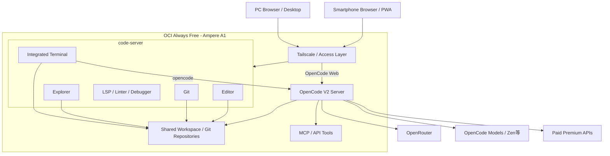
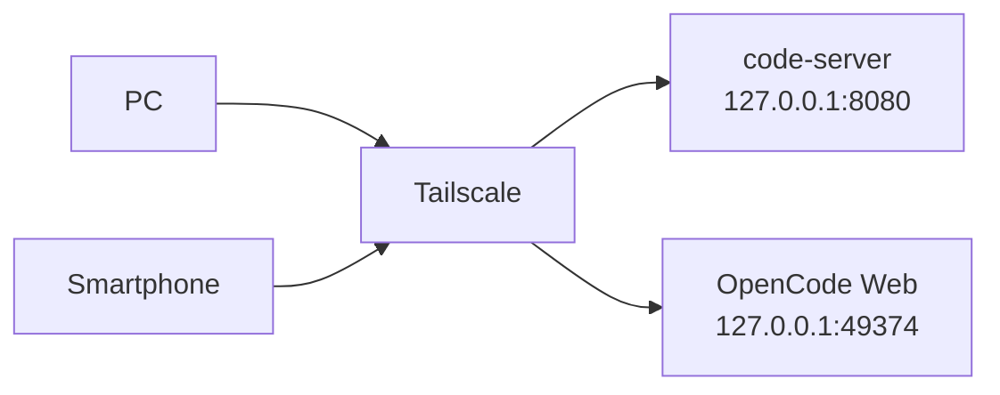

> **Status: incorporated.** This report is an input to ADR-0001 and is kept
> for context. The unified architecture is defined in
> [ADR-0001](../../adr/0001-unified-architecture.md).
>
> **2026-11-15 注記:** OCI は使用しない方針（[ADR-0004](../../adr/0004-local-only-no-oci.md)）により、本書の OCI/OpenTofu/cloud-init/Tailscale 常設等の前提は現行インフラ手順ではありません。現行の残タスク・運用状況は [docs/integration/remaining-tasks.md](../../docs/integration/remaining-tasks.md) を参照してください。

## エグゼクティブサマリー

現時点の推奨構成は、**OCI Always Free上に `code-server` と
OpenCode V2を同居させる一人用リモート開発環境**である。

`code-server` は人間が操作するブラウザIDEを担当し、
OpenCode V2は同じリポジトリを操作するAIコーディングエージェントを担当する。
OpenCodeはIDEではないため、この分離が役割として明確である。

PCではcode-serverのエディタ、LSP、Git、統合ターミナルを利用し、
必要に応じて統合ターミナルから `opencode` を起動する。
OpenCode Webも同じOCIホストで常設し、PC・スマートフォンから
別タブまたはPWAとして直接利用する。

スマートフォンは**クライアント専用**とし、
OpenCode、code-server、ローカルLLMのセルフホスト先にはしない。
バッテリー消費、発熱、Androidのバックグラウンド制御、
持続性能を考えると、常設サーバ用途にする合理性が低いためである。

インフラはOpenTofuでIaC化する。
ただし初期段階ではKubernetes等を導入せず、
**OpenTofu + cloud-init + systemd + Tailscale**を基本とする。

推論は単一ベンダーへ固定せず、OpenRouter Free、
OpenCode側の無料・低価格モデル、安価な有料モデル、
高性能モデルへ段階的にエスカレーションする。

## 現在までの確定事項

| 項目 | 方針 |
| --- | --- |
| クラウド | OCI |
| OCIアカウント | 作成済み |
| OCI API署名キー | 作成・ローカル設定済み |
| IaC | OpenTofu |
| ブラウザIDE | code-serverを第一候補 |
| AIコーディングエージェント | OpenCode V2 |
| OpenCode TUI | code-server統合ターミナルから利用 |
| OpenCode Web | OCI上で常設し、別URL/PWAから利用 |
| スマホ | クライアント専用 |
| スマホでのセルフホスト | 行わない |
| リポジトリ | code-serverとOpenCodeで同一working treeを共有 |
| モデル | OpenRouter / OpenCode側モデル / 各社APIを併用 |
| MCP | OpenCode側へ段階導入 |
| 個人SaaS連携 | 既存ChatGPT等の公式コネクタも当面維持 |
| ネットワーク | Tailscale優先、必要ならHTTPSリバースプロキシ |
| コンテナ | 初期構成では必須にしない |

OpenTofuのインストール完了有無は未確認である。

## 推奨アーキテクチャ



### 役割分担

`code-server` は次を担当する。

- コードエディタ
- ファイルツリー
- 統合ターミナル
- Git UI
- LSP
- Linter
- Debugger
- Open VSX拡張

code-serverはブラウザでVS Code系の開発環境を提供し、
Open VSXを標準の拡張機能ギャラリーとして利用する。
Microsoft Marketplaceは非Microsoft版VS Codeからの利用条件に制約がある。
[code-server FAQ](https://coder.com/docs/code-server/FAQ)

OpenCode V2は次を担当する。

- リポジトリ探索
- コード生成・編集
- Shell実行
- テスト
- AIレビュー
- MCP
- モデル切替
- TUI / Web / 非対話実行

OpenCode V2は公式に「open source AI coding agent」と位置付けられており、
ターミナル、デスクトップ、Webの各UIを持つ。
[OpenCode V2 Intro](https://opencode.ai/v2/docs)

## OpenCodeの利用形態

### TUI

code-serverの統合ターミナルから、開いているリポジトリで実行する。

```bash
cd ~/repos/example
opencode
```

これによりcode-serverのエディタとOpenCodeが同じworking treeを操作する。

```text
code-server Editor
        │
        ▼
~/repos/example
        ▲
        │
OpenCode TUI
```

### Web

OpenCode V2 WebはTUIと同じサーバから提供される。
既定ではlocalhostのポート49374で待ち受け、
`opencode pair` で接続情報を取得できる。

[OpenCode V2 Web](https://opencode.ai/v2/docs/cli/web/)

常設・リモートホストではforegroundサーバを起動する方法が明確である。

```bash
opencode serve --hostname 127.0.0.1 --port 49374
```

systemdで管理し、外部には直接公開せず、
Tailscaleまたはリバースプロキシ経由で到達させる。

### 非対話実行

CI的なタスクや一回限りの処理では、
対話UIを開かずにOpenCodeを実行する構成も残す。

## PCとスマートフォンのUX

### PC

PCでは次のいずれかを使う。

```text
左: code-server
右: OpenCode Web
```

または、

```text
code-server
└─ Integrated Terminal
   └─ OpenCode TUI
```

PCではOpenCode WebとTUIの両方を使えるようにし、
作業内容によって切り替える。

### スマートフォン

スマートフォンではOpenCode TUIを
code-serverの統合ターミナル内にさらに表示するより、
**OpenCode Webを直接開く方を基本**とする。

ホーム画面上では次のように分離する。

```text
IDE
└─ code-server PWA

AI Agent
└─ OpenCode Web PWA
```

code-server側は狭い画面で複数ペインを同時表示しない。

```text
Editor
  ↕
Explorer
  ↕
Terminal
```

のように1画面ずつ切り替える。

### モバイルUI修正

優先順位は次のとおり。

1. VS Code標準レイアウト設定
2. UserCSS
3. UserScript
4. 必要な箇所だけcode-server本体へパッチ

code-server公式FAQでもPWA利用によるブラウザショートカット問題の軽減が
案内されている。
[code-server FAQ](https://coder.com/docs/code-server/FAQ)

UserScriptでは、スマートフォン専用の操作バーを追加する余地がある。

```text
┌────────────────────────┐
│                        │
│        Editor          │
│                        │
├────────────────────────┤
│ Files | Term | AI | Git│
└────────────────────────┘
```

ただしMonaco Editorそのもののタッチ処理や、
拡張機能Webview内部はUserCSS/UserScriptだけで完全に制御できない可能性がある。

## 拡張機能戦略

code-serverはOpen VSXを標準利用でき、
VSIXの手動インストールにも対応する。

[code-server FAQ](https://coder.com/docs/code-server/FAQ)

基本方針は次の順序とする。

1. Open VSXにある拡張を利用する。
2. Open VSXにない場合は公式GitHub Releases等のVSIXを確認する。
3. Microsoft固有拡張はライセンスと互換性を個別確認する。
4. Remote SSH / WSL / Containers等はOCI上では必要性を再評価する。

OCI上で既にリモート開発環境へ入っているため、
ローカルVS Codeで必要だったRemote系拡張の一部は不要になる。

拡張機能のセットはIaCまたは構成管理で再現可能にする。

```bash
code-server --install-extension rust-lang.rust-analyzer
code-server --install-extension redhat.java
code-server --install-extension dbaeumer.vscode-eslint
```

## OCI Always Freeの設計

現行Oracle公式ドキュメントでは、
Always Freeの`VM.Standard.A1.Flex`は合計で次の枠である。

- 2 OCPU
- 12 GB RAM
- A1 Compute全体で月1,500 OCPU hours
- 月9,000 GB hours
- Always Free Block Volume合計200 GB

[Oracle Always Free Resources](https://docs.oracle.com/en-us/iaas/Content/FreeTier/freetier_topic-Always_Free_Resources.htm)

OpenCode、code-server、Git、LSP、MCPの常設ホストとしては
比較的余裕のあるメモリ容量である。

ただしCPUは2 OCPUなので、巨大ビルドや重量級Javaプロジェクトを
常時高速に回す用途には限界がある。

### ローカルLLM

OCI A1上でローカルLLMを主力推論基盤にはしない。

理由は次のとおり。

- GPUがない。
- CPU推論に2 OCPUを消費するとIDE/Agentの応答性が落ちる。
- クラウドAPIの方が性能・電力効率面で合理的。
- 12 GB RAMはIDEと開発環境にも利用したい。

ローカルLLMを導入する場合は、
自宅PC等の別ホストで実行し、必要ならTailscale経由で接続する。

## OCI無料枠の重要リスク

### Critical: Idle Computeの回収

OracleはAlways Free Computeについて、
7日間にわたりCPU・Network・Memoryが一定基準未満の場合、
Idle Computeとして回収する可能性があると明記している。

[Oracle Always Free Resources](https://docs.oracle.com/en-us/iaas/Content/FreeTier/freetier_topic-Always_Free_Resources.htm)

したがってOCI Always Freeを
**永続性を保証されたサーバとは扱わない**。

対策は負荷を人工的に発生させることではなく、
サーバが消えても再構築できるようにすることである。

- OpenTofuでインフラを再現する。
- cloud-init / systemdでソフトウェアを再構成する。
- GitリポジトリはGitHub等をsource of truthとする。
- code-server設定・OpenCode設定をバックアップする。
- APIキーは別管理する。
- 重要データをOCI VMだけに置かない。

### High: Arm64互換性

A1はArm64であるため、
使用するCLI、拡張機能、ネイティブモジュールがArm64に対応している必要がある。

OpenCode V2はプラットフォーム向けネイティブバイナリを配布している。
[OpenCode V2 Intro](https://opencode.ai/v2/docs)

導入予定のJDK、Node.js、Rust、Maven、CMake、
ネイティブnpmパッケージ等は個別にArm64互換性を確認する。

### High: 外部公開

code-serverとOpenCodeは、
ファイル編集・Shell実行・Git・資格情報へアクセスできる。

認証だけでインターネットへ直接公開する構成は避ける。

初期段階ではTailscaleを推奨する。
Tailscale Personalには無料プランがある。
[Tailscale Free plans](https://tailscale.com/docs/reference/free-plans-discounts)

## 推論コスト最適化

推論は次の階層にする。

| Tier | 推論先 | 用途 |
| --- | --- | --- |
| 0 | 無料またはローカル前処理 | 整形、分類、単純処理 |
| 1 | OpenRouter Free | 軽い質問、一次解析 |
| 2 | 低価格有料モデル | 通常の実装・修正 |
| 3 | 高性能モデル | 難しい設計・デバッグ |
| 4 | ネイティブAIサービス | 公式コネクタが必要な処理 |

OpenRouter Freeは無料モデルを利用できるが、
Freeプランには50 requests/dayのレート制限がある。
[OpenRouter Pricing](https://openrouter.ai/pricing/)

`openrouter/free` は利用可能な無料モデルから、
tool calling等の要求に適合するモデルを選択するルーターとして提供されている。
[OpenRouter Free Models Router](https://openrouter.ai/openrouter/free)

無料モデルは能力・提供状況が変わるため、
特定モデルへの固定依存を避ける。

## MCP設計

OpenCode V2はMCPサーバを公式に扱える。

[OpenCode V2 MCP](https://opencode.ai/v2/docs/mcp-servers)

MCPを無制限に追加しない。
OpenCode公式も、MCPツールはモデルコンテキストを消費するため、
必要なサーバだけ追加するよう説明している。

導入順序は次のとおり。

1. 開発ドキュメント
2. GitHub等の開発系
3. Linear等のIssue管理
4. 読み取り中心SaaS
5. 書き込み可能SaaS
6. 個人・金融・健康データ

Zaim、Moneytree、マネーフォワード ME、Health等は、
公式または十分信頼できる接続方法がない限り
既存ChatGPT等のネイティブ連携を残す。

## IaC設計

### 基本スタック

```text
OpenTofu
├─ OCI Compartment
├─ VCN
├─ Subnet
├─ Internet Gateway
├─ Route Table
├─ NSG
├─ A1 Compute
└─ Block Volume

cloud-init
├─ packages
├─ user
├─ directories
├─ code-server install
├─ OpenCode V2 install
├─ Tailscale install
└─ systemd units

systemd
├─ code-server.service
└─ opencode.service
```

OpenTofuはproviderを通じて外部インフラを管理する。
providerのバージョン制約とdependency lock fileを利用することが
OpenTofu公式ドキュメントでも推奨されている。

[OpenTofu Providers](https://opentofu.org/docs/language/providers/)

### Git管理対象

```text
infra/
├─ versions.tf
├─ provider.tf
├─ variables.tf
├─ network.tf
├─ compute.tf
├─ outputs.tf
├─ cloud-init.yaml
├─ systemd/
│  ├─ code-server.service
│  └─ opencode.service
└─ README.md
```

Git管理する。

- `*.tf`
- cloud-init
- systemd unit
- `.terraform.lock.hcl`
- code-server拡張一覧
- OpenCodeの非秘密設定

Git管理しない。

- OCI API秘密鍵
- OpenRouter API Key
- OpenAI / Anthropic / Gemini API Key
- OAuth token
- Tailscale auth key
- `*.tfstate`
- secretを含む`.tfvars`

OpenTofuのstateはインフラ情報を含むため、
リポジトリへcommitしない。

単独利用の初期段階ではローカルstateで開始し、
必要になった時点でリモートstateへ移行する。

## ネットワーク構成

初期構成は次を推奨する。



OCI Security List / NSGでは、
不要なアプリケーションポートをインターネットへ開放しない。

SSHもTailscale経由へ寄せられるなら、
最終的にはpublic SSHを閉じる方向で検討する。

独自ドメインや一般Webアクセスが必要になった場合のみ、
CaddyまたはNginx等のHTTPSリバースプロキシを追加する。

## 移行手順

### Phase 0: 現在地

完了済み。

- OCI Cloud Account作成
- Home Region選択
- OCI API署名キー作成
- `~/.oci/config` 設定
- 秘密鍵権限設定

確認待ち。

- OpenTofuインストール

### Phase 1: OpenTofu疎通

```bash
tofu version
```

未導入ならOpenTofuをインストールする。

読み取り専用のOCI data sourceだけを定義し、

```bash
tofu init
tofu fmt
tofu validate
tofu plan
```

まで通す。

この段階ではOCIリソースを作成しない。

### Phase 2: OCI最小インフラ

IaCで次を作成する。

- 専用Compartment
- VCN
- Subnet
- NSG
- A1 Flex 2 OCPU / 12 GB
- Ubuntu Arm64
- Boot Volume

`tofu plan`を確認してから`tofu apply`する。

### Phase 3: アクセス基盤

cloud-initでTailscaleを導入する。

最初はSSHで動作確認し、
Tailscale経由でアクセスできたら
アプリケーションポートのpublic公開を行わない。

### Phase 4: code-server

code-serverをsystemdで常設する。

確認項目。

- ログイン
- ファイル編集
- Git
- Terminal
- Open VSX
- LSP
- PC表示
- スマホ表示

### Phase 5: OpenCode V2

同一LinuxユーザーにOpenCode V2を導入する。

```bash
cd ~/repos/example
opencode
```

をcode-serverの統合ターミナルから起動し、
同じworking treeを編集できることを確認する。

次にOpenCode Webをsystemdで常設する。

```bash
opencode serve --hostname 127.0.0.1 --port 49374
```

### Phase 6: 推論プロバイダー

順に追加する。

1. OpenRouter Free
2. OpenCode側の無料モデル
3. 低価格モデル
4. 必要な有料高性能モデル

いきなり高性能モデルをデフォルトにしない。

### Phase 7: MCP

GitHubや技術ドキュメント等、
低リスクな読み取り用途から追加する。

OpenCode V2ではMCPをCLIから管理できる。
[OpenCode V2 Commands](https://opencode.ai/v2/docs/cli/commands/)

### Phase 8: モバイルUI

標準UIで不便な点を実測してから修正する。

1. VS Code設定
2. PWA
3. UserCSS
4. UserScript

先に大規模なDOMハックを作らない。

### Phase 9: バックアップ・再構築試験

OCI VMが消えても復旧できることを確認する。

```text
tofu apply
  ↓
cloud-init
  ↓
code-server
  ↓
OpenCode V2
  ↓
git clone
  ↓
設定復元
```

この再構築試験が成功して初めて、
OCI Always Freeを日常環境として信用する。

## 重要度別の指摘

### Critical

#### C-01 OCI Always Freeを永続サーバとして扱わない

Idle Compute回収と容量不足の可能性がある。

**対応**:
IaC、Git、設定バックアップで再構築可能にする。

### High

#### H-01 インターネットへIDE/Agentを直接公開しない

code-serverとOpenCodeはShellとファイルへ強い権限を持つ。

**対応**:
Tailscaleを第一選択とし、
必要になるまでpublic reverse proxyを作らない。

#### H-02 秘密情報をOpenTofu state / Gitへ入れない

**対応**:
APIキーとOAuthトークンは別管理する。

#### H-03 Arm64互換性を事前確認する

**対応**:
必要なランタイム、LSP、拡張、CLIを一覧化し、
A1 VM構築前後に互換性テストを行う。

### Medium

#### M-01 スマホ最適化を先に作り込みすぎない

**対応**:
実機でcode-serverとOpenCode Webを動かしてから、
不足する操作だけUserScript化する。

#### M-02 無料モデルをAgentの全処理へ固定しない

**対応**:
無料モデルがtool callingやコード品質で不足した場合は
自動または手動で上位モデルへ昇格する。

#### M-03 OpenCode Webとcode-serverを一画面へ無理に埋め込まない

**対応**:
スマホでは別PWA、PCでは別タブまたは横並びを基本とする。

## 未解決事項

今後決める必要がある。

- OpenTofuをKubuntuへ導入済みか。
- OCI A1の東京リージョンで容量を確保できるか。
- UbuntuとOracle Linuxのどちらを採用するか。
- code-serverで必要な拡張のOpen VSX対応状況。
- code-serverのモバイル表示で実際に困るUI箇所。
- Tailscaleのみで運用するか、独自ドメインも利用するか。
- GitHub認証をHTTPS token、SSH key、GitHub Appのどれにするか。
- OpenCodeのどのモデルをTier 1～3へ割り当てるか。
- OpenRouterの月次上限額。
- IaC stateの長期保存先。
- OCI VMの設定バックアップ方式。
- ネイティブChatGPT / Claude / Geminiのうち、
  どのサブスクを公式コネクタ目的で残すか。

## 推奨する次の作業

現時点ではUI改造やMCPより先に、
**OpenTofuからOCIへ読み取り専用で疎通確認する**。

その後、

```text
OpenTofu
  ↓
A1 VM
  ↓
Tailscale
  ↓
code-server
  ↓
OpenCode V2 TUI
  ↓
OpenCode Web
```

の順に積み上げる。

この順序なら問題が発生した層を切り分けやすく、
OCI無料枠で環境を失ってもIaCから再構築できる。

## 参照資料

- [OpenCode V2](https://opencode.ai/v2/docs)
- [OpenCode V2 Web](https://opencode.ai/v2/docs/cli/web/)
- [OpenCode V2 MCP](https://opencode.ai/v2/docs/mcp-servers)
- [OpenCode V2 Commands](https://opencode.ai/v2/docs/cli/commands/)
- [code-server FAQ](https://coder.com/docs/code-server/FAQ)
- [code-server Browser IDE](https://coder.com/docs/user-guides/workspace-access/code-server)
- [Oracle Always Free Resources](https://docs.oracle.com/en-us/iaas/Content/FreeTier/freetier_topic-Always_Free_Resources.htm)
- [Oracle OCI Free Tier](https://docs.oracle.com/en-us/iaas/Content/FreeTier/freetier.htm)
- [OpenTofu Providers](https://opentofu.org/docs/language/providers/)
- [OpenRouter Pricing](https://openrouter.ai/pricing/)
- [OpenRouter Free Models](https://openrouter.ai/collections/free-models)
- [Tailscale Free Plans](https://tailscale.com/docs/reference/free-plans-discounts)
