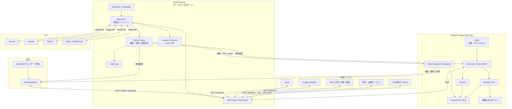
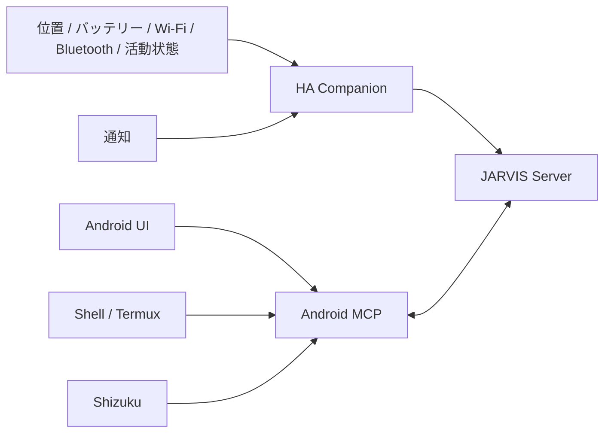
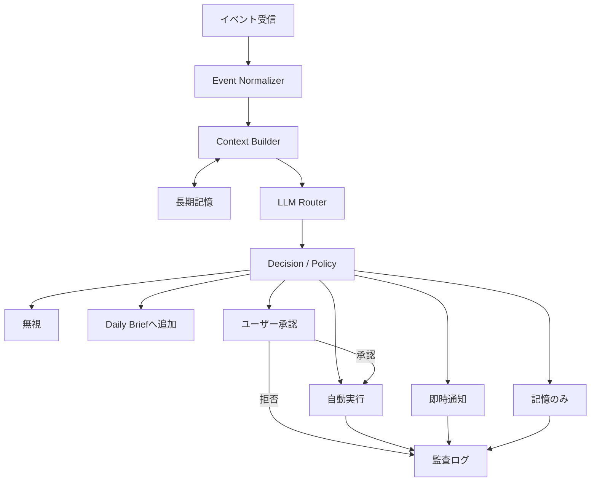
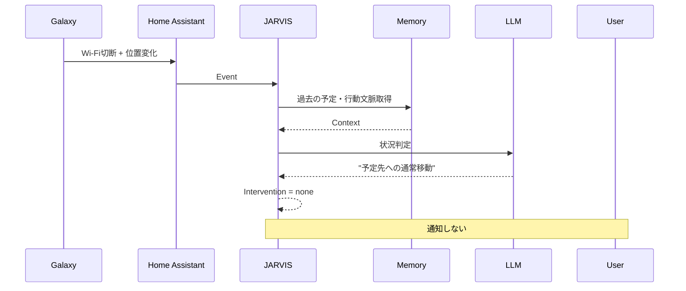
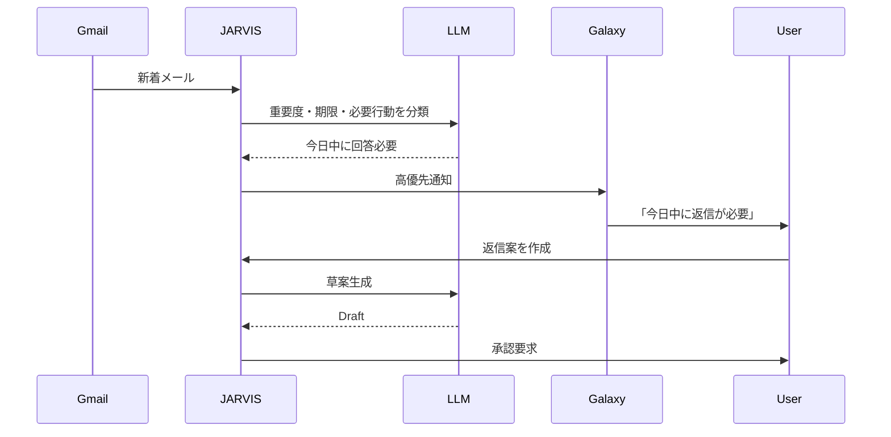
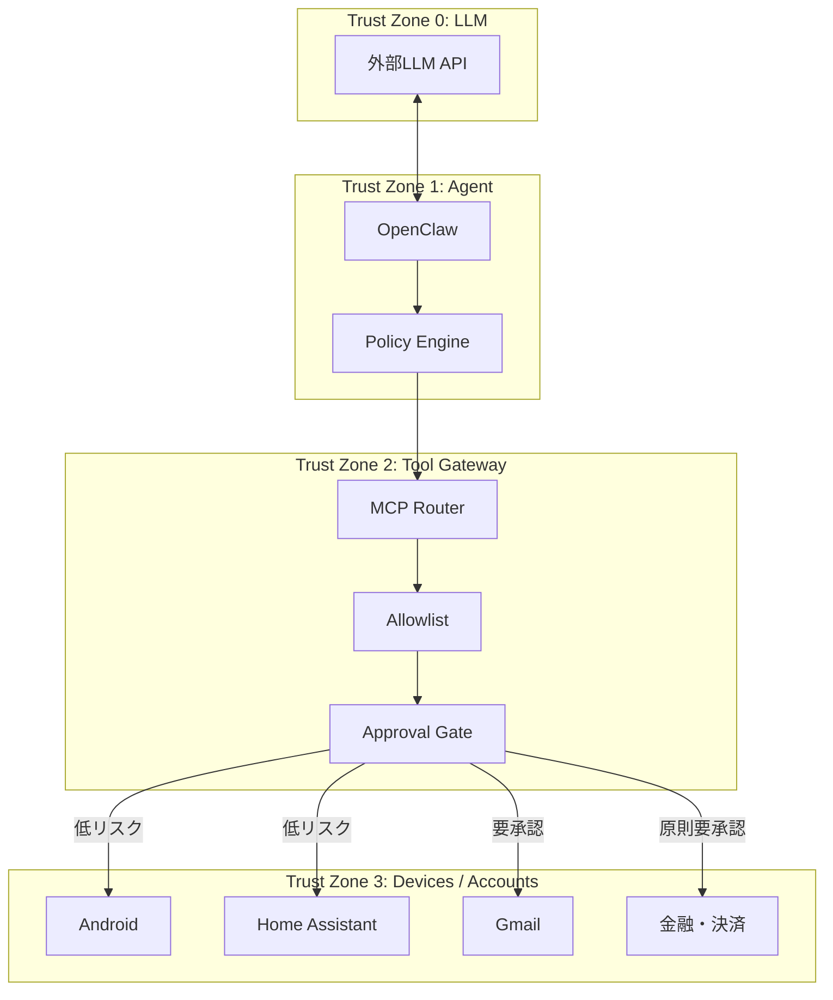
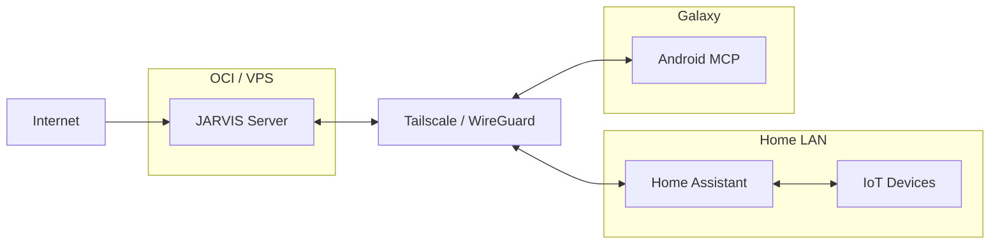
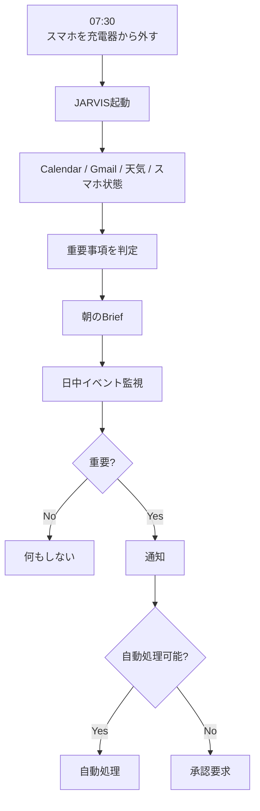
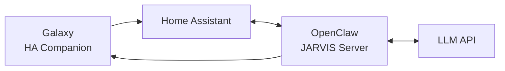

> **Status: superseded.** This document predates ADR-0001 and is kept for
> historical context. The current architecture is defined in
> [ADR-0001](../../adr/0001-unified-architecture.md) and the current
> infrastructure/deployment policy in
> [ADR-0004: Local-only (no OCI)](../../adr/0004-local-only-no-oci.md).
> References to OpenClaw and OCI-era assumptions describe the earlier design;
> OpenCode V2 is the current agent runtime and current operations are local
> Kubuntu + systemd (OCI unused).

## 目的

私生活を常時ポーリングするのではなく、スマホ・メール・予定・
スマートホームなどから発生するイベントを集約し、
AIが必要なときだけ通知・提案・自動処理する
JARVIS型パーソナルエージェントを構築する。

基本方針は次のとおり。

- **スマホ**: センサー、通知、位置、UI操作などの「目と手」
- **JARVIS Server**: 推論、判断、記憶、スケジュールの「脳」
- **Home Assistant**: 家・IoT・スマホ状態を集約するイベントバス
- **MCP**: 各システムをAIへ公開する標準インターフェース
- **LLM**: GPT、Claude、Gemini、Qwenなどを交換可能にする
- **危険な操作**: 原則として承認を要求する

## 全体構成



## スマホ側

### 役割

GalaxyはLLM本体を常時稼働させる場所ではなく、
**JARVISのセンサーハブ兼I/O端末**として扱う。



### 推奨コンポーネント

| コンポーネント | 役割 | 必須度 |
| --- | --- | --- |
| Home Assistant Companion | センサー・通知・位置の収集 | 高 |
| Termux | スクリプト、SSH、CLI処理 | 高 |
| Shizuku | rootなしで強いAndroid操作権限を提供 | 高 |
| droid-mcp系 | Android機能をMCP Toolとして公開 | 高 |
| Zafiro | スマホ側AI UI・直接操作 | 任意 |
| Tasker / MacroDroid | Androidイベントの補助自動化 | 任意 |

## サーバー側

### 推奨構成



### 主なサービス

| レイヤー | 推奨候補 | 目的 |
| --- | --- | --- |
| Agent Runtime | OpenClaw | 常駐エージェント、Tool実行 |
| Memory | Letta / PostgreSQL / SQLite | 長期記憶 |
| Scheduler | OpenClaw heartbeat / cron | 定期処理 |
| Smart Home | Home Assistant | IoT・スマホ状態集約 |
| Android Bridge | droid-mcp + Termux + Shizuku | Android操作 |
| Integration | MCP | Tool接続 |
| LLM Router | OpenRouter等 | モデル切替 |
| Secrets | Vault系 / OS Keyring | APIキー管理 |
| Audit | DB / append-only log | 行動記録 |

## イベント駆動

JARVISは常にLLMを回し続けるのではなく、
**意味のあるイベントが発生したときだけ起動する**。



### 重要イベントの例



## 介入ポリシー

通知疲れを防ぐため、AIの判断結果を最低でも次の5段階に分離する。

| Level | 処理 | 例 |
| --- | --- | --- |
| 0 | 無視 | 通常の位置移動 |
| 1 | 記憶のみ | 日常的な利用傾向 |
| 2 | Daily Brief | 急がない予定・支出 |
| 3 | 即時通知 | 今日中の期限、交通障害 |
| 4 | 承認要求 | メール送信、購入、設定変更 |
| 5 | 自動実行 | 明示的に事前許可した低リスク処理 |

## セキュリティ境界

AIエージェントへ最初から全権限を与えない。



### 原則

- LLMへAPIキーそのものを見せない。
- MCPサーバーごとに権限を分離する。
- 読み取り権限と書き込み権限を分ける。
- Android shellはallowlist方式にする。
- Shizuku経由の危険なコマンドを直接LLMへ公開しない。
- メール送信、購入、送金、削除は原則承認制にする。
- すべての自動操作を監査ログへ残す。
- 秘密情報をMemoryへ保存しない。
- 外部からAndroid MCPへ直接到達させない。

## ネットワーク構成



外部公開するのは原則JARVIS Serverのみとし、
Home AssistantとAndroid MCPはVPN内へ閉じる。

## 日常利用イメージ



## 実装順

1. **Home Assistantをハブ化**
   - GalaxyへCompanion Appを導入。
   - バッテリー、ネットワーク、通知など必要なセンサーだけ有効化。
   - SwitchBot等をHome Assistantへ統合。

2. **GalaxyをTool Provider化**
   - Termuxを構築。
   - Shizuku + rishを設定。
   - Android MCPをTermux側へ接続。
   - 読み取り系Toolから公開する。

3. **JARVIS Serverを構築**
   - OCI / VPSへ常駐Agent Runtimeを配置。
   - MCP Clientを設定。
   - Home AssistantとAndroid MCPへVPN経由で接続。

4. **LLMを分離**
   - Agent Runtimeから直接特定モデルへ固定しない。
   - OpenAI、Claude、Gemini、Qwen等を切り替え可能にする。

5. **Memory追加**
   - 最初はSQLite/PostgreSQLで十分。
   - 長期人物モデルが必要になった段階でLetta等を追加。

6. **Policy Engine追加**
   - read-only
   - notify
   - approval-required
   - pre-approved automation

   の4種類程度から開始する。

7. **自動化を段階的に増やす**
   - 最初は観測と通知だけ。
   - 次にHome Assistant操作。
   - 最後にAndroid UIや外部サービスへの書き込みを許可する。

## 最小構成

最初から全部導入する必要はない。



この段階だけでも、

- 在宅・外出判定
- バッテリー状態
- Wi-Fi状態
- スマホ通知
- Calendar
- Gmail
- 天気
- Home Assistantイベント

を使った状況認識型エージェントを作れる。

その後、

```text
Termux
  ↓
Shizuku
  ↓
Android MCP
  ↓
JARVIS
```

を追加して、
**「観測するJARVIS」から「実際に操作するJARVIS」へ拡張する**
のが安全かつ実装しやすい。
